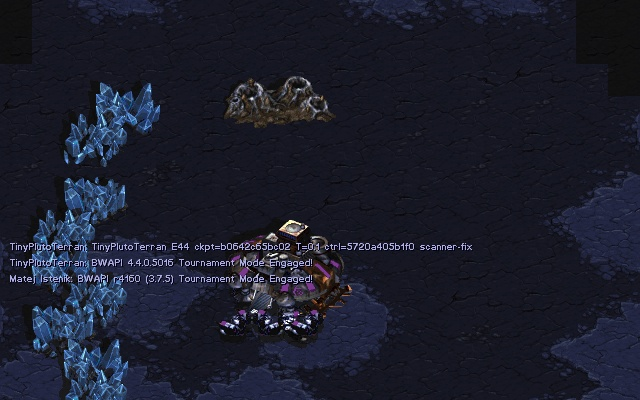

# Replay chat preview

The bundled classic and Remastered engines render recorded messages directly
in the game canvas with the classic StarCraft font, palette and placement.
Messages expire on the replay clock and are restored when seeking backward.
There is no additional history panel. The native Transmission.wav notification
uses the existing sound controls and is suppressed during paused/fast seeking.

Engine implementation: [dgant/openbw #2](https://github.com/dgant/openbw/pull/2),
branch `codex/replay-chat`.
See that change's `REPLAY_CHAT.md` for font provenance, implementation and tests.
This viewer update depends on that source change being reviewed first.

## Verification

- Both WebAssembly engines built using Emscripten 3.1.64, retaining the older
  compiler's five-MiB stack budget explicitly.
- Focused parser/font/bounds tests passed for both engine include paths with
  address and undefined-behavior sanitizers.
- Chrome playback of an unchanged classic replay showed recorded messages,
  expiry and native audio. Seeking forward then backward restored identical
  chat pixels; frame zero did not reveal future messages. Paused seeking did
  not replay notification sounds.
- The screenshot shows that actual classic replay, not injected overlay text.

Full release verification is pending: cross-browser/desktop suites and a full
Remastered browser match have not been run. Alternate-language glyph sets and
Remastered HD typography are not implemented. No game MPQs or replay files are
included in this change.
